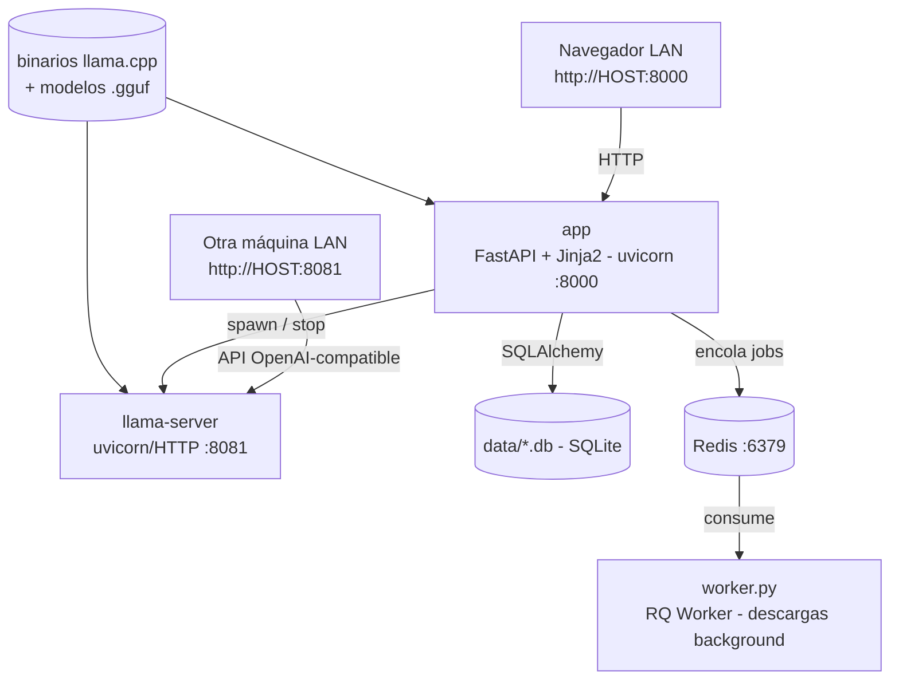

# llama-webapp (Llama Control Center LAN)

Aplicación web para gestionar modelos GGUF y levantar `llama-server` desde una interfaz FastAPI, con foco en Linux nativo. Eliges el binario `llama-server`, defines la carpeta de modelos, levantas el servidor desde la web, ves los logs y dejas el endpoint disponible para otras máquinas de la misma red.

[](https://github.com/bi0punk/llama-webapp/actions/workflows/ci.yml)
[](https://www.python.org/)
[](LICENSE)

## Contenido

- [Características](#características)
- [Arquitectura](#arquitectura)
- [Stack](#stack)
- [Estructura del repositorio](#estructura-del-repositorio)
- [Instalación](#instalación)
- [Uso](#uso)
- [Configuración](#configuración)
- [Tests / CI](#tests--ci)
- [Datos](#datos)
- [Roadmap](#roadmap)
- [Licencia](#licencia)

## Características

- Buscar binarios `llama-server`, `llama-run`, `llama-cli` en el sistema.
- Configurar carpeta de modelos persistente.
- Escanear e importar modelos `.gguf` ya existentes.
- Iniciar y detener `llama-server` desde la web.
- Ver el log del servidor y refrescar el tail automáticamente.
- Aplicar ajustes sugeridos por modelo: `threads`, `ctx-size`, `-ngl`, `extra_args`.
- Exponer una URL LAN clara para consumo desde otra máquina.
- Generar ejemplos de `curl` para pruebas rápidas.
- Ejecutarse como servicio `systemd` en Linux.
- Cola de jobs (RQ + Redis) para descargas en background.
- Autostart del último modelo tras reinicio del host.
- Autenticación opcional de la web con token (`LLAMA_WEB_TOKEN`).
- Métricas en vivo del proceso (CPU/RAM) y log del servidor por streaming SSE.
- Búsqueda de modelos y descarga de archivos `.gguf` directamente desde HuggingFace en la web.

## Arquitectura



- **app** (web): sirve la UI, gestiona el ciclo de vida de `llama-server` (spawn/stop), persiste modelos/ajustes en SQLite y expone endpoints JSON.
- **worker** (RQ): consume la cola Redis para jobs de descarga/limpieza largos; opcional si solo usas modelos ya en disco.
- **llama-server**: proceso externo gestionado por la app; expone la API OpenAI-compatible en el puerto configurado (por defecto 8081).

## Stack

- **Lenguaje**: Python 3.12+.
- **Web**: FastAPI + Uvicorn + Jinja2 (templates HTML, JS/TypeScript en `app/static/`).
- **Cola**: Redis + RQ (worker separado para descargas/jobs).
- **Persistencia**: SQLAlchemy (SQLite en `data/`).
- **Validación**: Pydantic v2.
- **Calidad**: ruff (lint+format), mypy (strict), pytest.
- **Empaquetado**: `pyproject.toml` como única fuente de deps; `setuptools` build backend.
- **Frontend TS**: TypeScript compilado a `app/static/js` (build con `tsc`, ver `package.json`).
- **Despliegue**: Docker multi-stage (targets `web`/`worker`) + systemd (Linux nativo).

## Estructura del repositorio

```
llama-webapp/
├── app/                            # Aplicación FastAPI
│   ├── main.py                     # App + montaje de rutas
│   ├── config.py                   # Configuración (env, defaults)
│   ├── auth.py                     # Autenticación por token (opcional)
│   ├── db.py                       # SQLAlchemy / SQLite
│   ├── models.py                   # Modelos de datos
│   ├── queue.py / tasks.py         # Cola RQ + tareas
│   ├── llama_server_manager.py     # Ciclo de vida del subproceso
│   ├── discovery.py                # Escaneo de .gguf
│   ├── runtime_settings.py / system_info.py
│   ├── repositories/               # Capa de repositorios
│   ├── services/                   # binary, chat, curl, huggingface, model, profile
│   ├── routes/                     # api, web, actions
│   ├── templates/                  # Jinja2 (base, server, models, jobs, playground…)
│   └── static/                     # JS/TS (hf, playground, server, types)
├── worker.py                       # Worker RQ (cola Redis)
├── tests/                          # Suite pytest (12 archivos)
├── scripts/                        # bootstrap, start_web, start_worker, install_systemd
├── deploy/systemd/                 # Plantillas de servicios + env example
├── examples/curl_examples.sh       # Ejemplos de consumo
├── Dockerfile                      # Multi-stage (targets web / worker)
├── docker-compose.yml              # Redis + web + worker
├── package.json / tsconfig.json    # Build TypeScript
├── pyproject.toml                  # Única fuente de deps (runtime + [dev])
└── .env.example
```

## Instalación

### Requisitos

- Linux nativo.
- Python 3.12+.
- Redis local si usarás descargas en background.
- `llama.cpp` compilado o instalado en el host.

Rutas donde la aplicación intentará encontrar `llama-server`:

- `/usr/local/bin`, `/usr/bin`, `~/opt/llama.cpp/build/bin`, `~/llama.cpp/build/bin`, `~/.local/bin`, `/opt/llama/bin`.

### Pasos

Con `uv` (recomendado):

```bash
cd /ruta/del/proyecto
uv venv -p 3.12 .venv
uv pip install -e ".[dev]"
```

O con `pip` estándar:

```bash
python3.12 -m venv .venv
source .venv/bin/activate
pip install -e ".[dev]"
```

Bootstrap completo (crea `.venv`, instala deps y deja directorios base):

```bash
./scripts/bootstrap_native_linux.sh
```

### Redis local

```bash
sudo apt-get update
sudo apt-get install -y redis-server
sudo systemctl enable --now redis-server
```

Si solo vas a usar modelos ya presentes en disco, el worker no es obligatorio, pero Redis sigue siendo recomendable para mantener el proyecto consistente.

## Uso

### Arranque manual

```bash
./scripts/start_web.sh      # web
./scripts/start_worker.sh   # worker
```

### Flujo operativo

1. La UI corre en `http://IP_DEL_HOST:8000`.
2. Desde la UI eliges el binario `llama-server` y un modelo `.gguf`.
3. La UI inicia `llama-server` con los parámetros definidos.
4. El servidor LLM queda accesible por LAN en `http://IP_DEL_HOST:8081`.
5. Otra máquina de la red puede consumir el endpoint OpenAI-compatible.

### Ejemplos de curl

Desde la misma máquina:

```bash
curl -s http://127.0.0.1:8081/health
curl -s http://127.0.0.1:8081/v1/models
curl -s http://127.0.0.1:8081/v1/chat/completions \
  -H 'Content-Type: application/json' \
  -d '{"model":"llama-local","messages":[{"role":"user","content":"Hola"}],"temperature":0.2}'
```

Desde otra máquina en la LAN:

```bash
curl -s http://IP_DE_TU_SERVIDOR:8081/health
curl -s http://IP_DE_TU_SERVIDOR:8081/v1/chat/completions \
  -H 'Content-Type: application/json' \
  -d '{"model":"llama-local","messages":[{"role":"user","content":"Dame un resumen técnico"}],"temperature":0.2}'
```

### Instalar como servicio systemd

```bash
./scripts/bootstrap_native_linux.sh
sudo ./scripts/install_systemd.sh
```

Eso crea `llm-control-center-web.service`, `llm-control-center-worker.service` y `deploy/systemd/llm-control-center.env`.

```bash
sudo systemctl daemon-reload
sudo systemctl enable --now llm-control-center-web
sudo systemctl enable --now llm-control-center-worker
sudo systemctl status llm-control-center-web
sudo journalctl -u llm-control-center-web -f
```

Sin worker:

```bash
sudo INSTALL_WORKER=no ./scripts/install_systemd.sh
sudo systemctl enable --now llm-control-center-web
```

### Despliegue con Docker Compose

```bash
docker compose up --build
```

La web queda en `http://localhost:8000`. El `redis` incluye healthcheck y la web/worker dependen de él. El contenedor monta `data_vol` (datos runtime), `models_vol` (modelos `.gguf`) y el binario de `llama.cpp` desde `/opt/llama/bin` en el host (solo lectura); asegúrate de que ese binario exista antes de levantar el stack.

## Configuración

Desde la UI en `http://IP_DE_TU_MAQUINA:8000/server`:

- `Bind host = 0.0.0.0`.
- `Puerto servidor = 8081`.
- `Host LAN publicado = IP real del equipo`.
- `Binario = ruta real de llama-server`.
- `Carpeta de modelos = ruta donde guardas los .gguf`.

Después: escanea o importa modelos locales, selecciona uno, aplica el perfil sugerido (opcional), inicia `llama-server` y revisa los logs.

Las variables de entorno son las que define `app/config.py` y `.env.example` (rutas de datos/modelos/binarios, Redis, servidor por defecto, red y `HUGGING_FACE_TOKEN`). La app carga automáticamente el archivo `.env` si existe; las variables ya exportadas en el entorno tienen prioridad. El resto de ajustes runtime se persisten en `data/` vía la UI en `/server`.

Variables principales (ver `.env.example`):

| Variable              | Default                           | Descripción                               |
|-----------------------|-----------------------------------|-------------------------------------------|
| `DATA_DIR`            | `data/` (ruta del proyecto)       | Directorio de datos, logs y SQLite        |
| `REDIS_URL`           | `redis://127.0.0.1:6379/0`        | Broker/cola de jobs                       |
| `DEFAULT_MODELS_DIR`  | `data/models`                     | Carpeta de modelos `.gguf`                |
| `LLAMA_SEARCH_PATHS`  | —                                 | Rutas extra de binarios (separadas por `:`) |
| `MODEL_SCAN_PATHS`    | —                                 | Rutas extra de escaneo de `.gguf`         |
| `LLAMA_SERVER_BIN`    | `/opt/llama/bin/llama-server`     | Binario por defecto                      |
| `DEFAULT_SERVER_HOST` | `127.0.0.1`                       | Host del servidor LLM                     |
| `DEFAULT_SERVER_PORT` | `8081`                            | Puerto del servidor LLM                   |
| `WEB_HOST` / `WEB_PORT` | `0.0.0.0` / `8000`              | Bind de la web                            |
| `LLAMA_WEB_TOKEN`     | (vacío)                           | Token opcional para proteger la web       |
| `HUGGING_FACE_TOKEN`  | —                                 | Token de HuggingFace para modelos privados |

### Proteger la web con token (opcional)

Define `LLAMA_WEB_TOKEN` en el entorno o `.env`. Con token presente, toda la web exige login (`/login`), se firma una cookie de sesión (HMAC, 90 días) y se muestra el botón "Cerrar sesión". Sin token, la web queda abierta. `/health` y los estáticos siguen públicos; los endpoints `/api/*` devuelven `401` si no hay sesión.

## Tests / CI

```bash
pytest -v
```

Calidad estática:

```bash
ruff check .
mypy app/ worker.py
```

Cobertura actual (12 archivos):

- `tests/test_config.py` — carga de configuración.
- `tests/test_gguf_validation.py` — validación de cabecera GGUF.
- `tests/test_model_profiles.py` — perfiles y estimación de RAM.
- `tests/test_binary_service.py` — descubrimiento/versión de binarios.
- `tests/test_discovery.py` — escaneo de archivos `.gguf`.
- `tests/test_repositories.py` — repositorios de datos (models, jobs, registry).
- `tests/test_services.py` — url, profile, curl y model services.
- `tests/test_llama_server_manager.py` — ciclo de vida del subproceso.
- `tests/test_tasks.py` — descarga de modelos (url/paths/errores).
- `tests/test_routes.py` — endpoints HTTP (health, discovery, acciones).
- `tests/test_integration.py` — ciclo start/stop de `llama-server` vía TestClient + `/health`.
- `tests/test_smoke.py` — migración RQ en `worker.py`, render de partials y endpoints de discovery/curl.

Los tests de integración usan `TestClient` (FastAPI) y levantan una SQLite efímera; no requieren `llama-server` real (se mockea el spawn).

CI — GitHub Actions (`.github/workflows/ci.yml`), 4 jobs sobre Python 3.12 / ubuntu-latest, disparados en push y PR a `main`/`master`:

- **lint** — `ruff check .`.
- **typecheck** — `mypy app/ worker.py` (strict).
- **test** — instala el paquete con extras de dev y ejecuta `pytest -q --cov=app --cov=worker`.
- **docker** — `docker build --target web` y `--target worker` (Buildx).

## Datos

Directorio y artefactos runtime (todos gitignored salvo `models/.gitkeep`):

- `data/` — SQLite (`*.db`), runtime settings, registros.
- `data/logs/llama_server.log` — log del servidor gestionado.
- `data/logs/job_<id>.log` — log por job de la cola.
- `models/` — carpeta de modelos `.gguf` (vacía por defecto, el usuario la llena).

Logs de systemd:

```bash
sudo journalctl -u llm-control-center-web -f
sudo journalctl -u llm-control-center-worker -f
```

Consideraciones de producción:

1. `llama-server` seguirá siendo gestionado por la UI. El servicio systemd mantiene viva la aplicación web y el worker.
2. Si reinicias el host, la UI vuelve automáticamente; luego puedes volver a iniciar el modelo desde la web.
3. Si expones `8081` a toda la LAN, revisa firewall y segmentación.
4. En CPU-only conviene partir con modelos cuantizados moderados y `--parallel 1` si priorizas estabilidad.

## Roadmap

- [x] Gestión de binarios, modelos y ciclo de vida de `llama-server` desde la web.
- [x] Cola de descargas con RQ + Redis.
- [x] Despliegue systemd y Docker multi-stage.
- [x] Autenticación opcional con token.
- [ ] Endurecer aún más mypy strict (p. ej. `disallow_untyped_defs`) requiere anotar el código legacy restante.

## Licencia

MIT — ver [LICENSE](LICENSE).